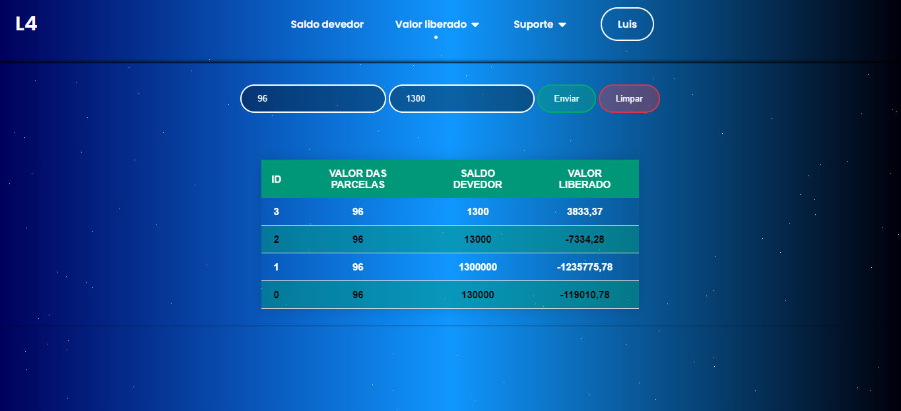
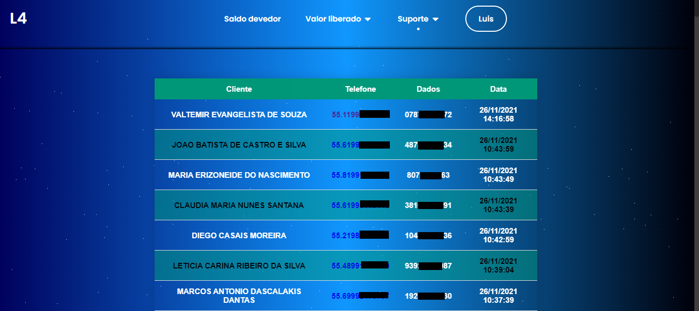

# e-Consignado — sistema experimental em PHP

**Projeto histórico para apoiar rotinas de empréstimo consignado, com telas de cálculo e cadastro de informações.**

 

## Funcionalidades retratadas no projeto

- Interface de entrada e navegação.
- Calculadora para cenários de consignado.
- Ferramentas de leitura/análise de informações de certificados.
- Registro e consulta de informações por telas e rotas PHP.

## Capturas de tela

| Tela | Prévia |
| --- | --- |
| Início |  |
| Calculadora |  |
| Análise |  |
| Registros |  |

## Estrutura e execução

O repositório contém arquivos `.php`, estilos, scripts e componentes de interface. Para executar localmente, é necessário um servidor PHP e revisar a configuração do banco de dados presente no projeto.

**Atenção:** trata-se de código legado, sem auditoria de segurança atual documentada. Não exponha em produção e não utilize dados reais de clientes sem revisar credenciais, autenticação, armazenamento de informações e requisitos legais aplicáveis.

## Evoluções recomendadas

- Isolar segredos em variáveis de ambiente.
- Atualizar dependências e remover dados sensíveis de exemplos.
- Adicionar testes para cálculos, acesso e cadastros.
- Documentar as premissas financeiras e as limitações legais de cada simulação.

Criado por [Hélio Conde](https://github.com/HelioConde).
